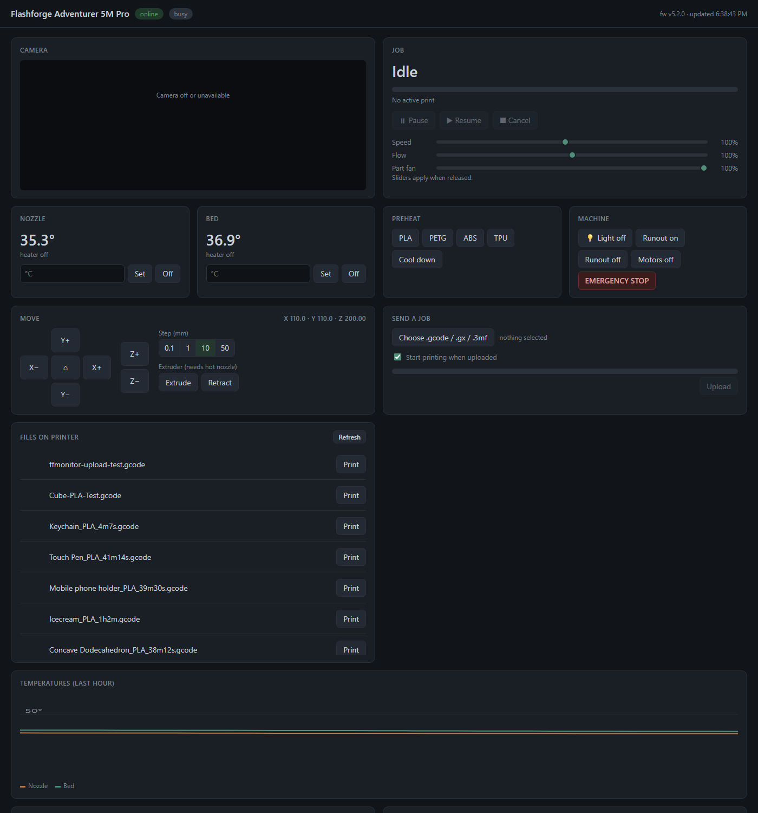

# FlashForge Monitor

A small, self-hosted web dashboard to **watch and fully control a FlashForge Adventurer 5M / 5M Pro over your local network**: no cloud account, no vendor app, no internet access needed for the printer.

Runs anywhere .NET runs: **Raspberry Pi**, any Linux box, Docker, Windows or macOS. One process, ~50 MB RAM.



## Features

| | Works without LAN mode | Needs LAN-only mode |
|---|:---:|:---:|
| Live status: state, progress, layer, file, nozzle/bed temps, head position | ✅ | |
| Live camera (5M Pro, or 5M with camera add-on), proxied so any browser on your network can see it | ✅ | |
| Pause / resume / cancel, emergency stop | ✅ | |
| Upload G-code (optionally start printing right away) | ✅ | |
| Files on the printer with thumbnails, start any of them | ✅ | |
| Set nozzle / bed temperature, preheat presets (PLA / PETG / ABS / TPU), cool down | ✅ | |
| Jog X / Y / Z, home, extrude / retract, motors off | ✅ | |
| Print speed, flow and part-fan sliders | ✅ | |
| Light on/off, filament runout sensor on/off | ✅ | |
| Console: send any G-code / M-code and see the reply | ✅ | |
| Temperature chart (last hour) | ✅ | |
| Print history (finished / stopped, duration) | ✅ | |
| Notifications to **ntfy**, **Discord** or any webhook: started, finished, stopped, paused, offline | ✅ | |
| Optional password (HTTP Basic auth) | ✅ | |
| Extra details: chamber temp, fan speeds, door, filament used, time left, lifetime stats, free disk | | ✅ |
| Camera on/off, air filtration (internal/external), clear platform | | ✅ |

Everything in the first column talks to the printer's TCP control port (8899), which the printer always exposes on your network. LAN-only mode is an optional extra.

## Quick start

You need the printer's IP address (printer screen → **Settings → Network**). Give it a fixed IP/DHCP reservation in your router so it doesn't change.

### Option 1: Raspberry Pi / Linux (one command)

```bash
curl -fsSL https://raw.githubusercontent.com/dougkl/flashforge-monitor/main/deploy/install.sh | sudo bash -s -- 192.168.1.50
```

Replace `192.168.1.50` with your printer's IP. This downloads the latest release for your CPU (64-bit, 32-bit ARM or x64), installs it to `/opt/flashforge-monitor`, and starts it as a systemd service on boot. Open **`http://<pi-ip>:5080`**.

Run the same command again to update. Logs: `journalctl -u flashforge-monitor -f`.

### Option 2: Docker

```bash
docker run -d --name flashforge-monitor --restart unless-stopped \
  -p 5080:5080 -v ./data:/data \
  -e Printer__Host=192.168.1.50 \
  ghcr.io/dougkl/flashforge-monitor:latest
```

Or use [`docker-compose.yml`](docker-compose.yml). Images are published for `linux/amd64` and `linux/arm64`.

### Option 3: Download and run

Grab the archive for your platform from [Releases](https://github.com/dougkl/flashforge-monitor/releases) (`linux-x64`, `linux-arm64`, `linux-arm`, `win-x64`, `osx-arm64`). It's self-contained; no .NET install needed.

```bash
mkdir flashforge-monitor && tar -xzf flashforge-monitor-linux-arm64.tar.gz -C flashforge-monitor
cd flashforge-monitor
Printer__Host=192.168.1.50 ./flashforge-monitor
```

On Windows: unzip, then `set Printer__Host=192.168.1.50` and run `flashforge-monitor.exe`.

### Option 4: From source

```bash
git clone https://github.com/dougkl/flashforge-monitor
cd flashforge-monitor/src/FlashforgeMonitor
dotnet run -- --Printer:Host=192.168.1.50      # needs the .NET 10 SDK
```

## Configuration

Settings can go in `appsettings.local.json` next to the executable (never committed, see below), as environment variables (`Section__Key`), or as command-line arguments (`--Section:Key=value`).

```json
{
  "Printer": {
    "Host": "192.168.1.50",
    "CheckCode": ""
  },
  "Monitor": {
    "Password": ""
  },
  "Notifications": {
    "Webhooks": [
      { "Type": "ntfy", "Url": "https://ntfy.sh/my-secret-printer-topic" },
      { "Type": "discord", "Url": "https://discord.com/api/webhooks/…", "Events": ["finished", "cancelled", "offline"] }
    ]
  }
}
```

| Setting | Default | What it does |
|---|---|---|
| `Printer:Host` | *(required)* | Printer IP or hostname |
| `Printer:CheckCode` | | LAN-only mode check code (optional, unlocks the extras) |
| `Printer:SerialNumber` | auto | Detected from the printer; only set it to override |
| `Printer:PollSeconds` | `3` | How often status is read |
| `Printer:TcpPort` / `HttpPort` / `CameraPort` | `8899` / `8898` / `8080` | Printer ports |
| `Monitor:Password` | | If set, the web UI asks for a login (`Monitor:Username`, default `admin`) |
| `Monitor:DataDirectory` | `data` | Where print history is stored |
| `Urls` | `http://0.0.0.0:5080` | Address/port the web UI listens on |
| `Notifications:Webhooks` | `[]` | List of `{ Type, Url, Events }`. `Type` is `json` (default), `ntfy` or `discord`. `Events` empty = all of `started`, `finished`, `cancelled`, `paused`, `resumed`, `offline`, `online` |

Changes to `appsettings.local.json` are picked up without a restart. Use **Send test notification** at the bottom of the page to check webhooks.

### LAN-only mode (optional)

On the printer: **Settings → Network → LAN-only mode**. It shows a **check code**; put it in `Printer:CheckCode`. This unlocks the "Printer details" panel and the extra controls. Everything else works without it.

## Network tips

- **Different VLAN/subnet?** It works fine across VLANs. Allow the machine running FlashForge Monitor to reach the printer on TCP **8899** (control), **8080** (camera) and optionally **8898** (LAN-mode API). Auto-discovery isn't needed; the printer is addressed by IP.
- **Keep the printer off the internet**: you can block the printer's internet access at your router/firewall. FlashForge Monitor only talks to it locally.
- **Don't expose port 5080 to the internet.** It gives full control of the printer (including heaters). Set `Monitor:Password`, and use a VPN for remote access.

## Home Assistant

The JSON API is easy to use from Home Assistant's REST integration:

```yaml
rest:
  - resource: http://<monitor-ip>:5080/api/status
    scan_interval: 10
    sensor:
      - name: Printer state
        value_template: "{{ value_json.state }}"
      - name: Printer progress
        value_template: "{{ value_json.progress }}"
        unit_of_measurement: "%"
      - name: Printer nozzle
        value_template: "{{ value_json.nozzleTemp }}"
        unit_of_measurement: "°C"
      - name: Printer bed
        value_template: "{{ value_json.bedTemp }}"
        unit_of_measurement: "°C"
```

Camera: add a **MJPEG IP Camera** with URL `http://<monitor-ip>:5080/camera`.

## API

All endpoints return JSON; `POST` bodies are JSON.

| Method | Path | |
|---|---|---|
| GET | `/api/status` | Current status |
| GET | `/api/temps` | Temperature history (last hour) |
| GET | `/api/detail` | Full LAN-mode detail (needs check code) |
| GET | `/api/history` · DELETE `/api/history` | Print history / clear it |
| GET | `/api/files` | Files on the printer |
| GET | `/api/thumb?name=…` | File thumbnail (PNG) |
| POST | `/api/files/print` `{ "fileName": "x.gcode" }` | Start a stored file |
| POST | `/api/files/upload` (multipart: `file`, `printNow`) | Upload a file |
| POST | `/api/job/pause` · `resume` · `cancel` | Job control |
| POST | `/api/control/temp` `{ "nozzle": 210, "bed": 60 }` | Set temperatures |
| POST | `/api/control/speed` · `flow` · `fan` `{ "percent": 100 }` | Overrides |
| POST | `/api/control/jog` `{ "axis": "X", "distance": 10 }` | Relative move (X/Y/Z/E) |
| POST | `/api/control/home` · `motors-off` · `estop` | Machine |
| POST | `/api/control/light/on` · `off`, `/api/control/runout/on` · `off` | Light, runout sensor |
| POST | `/api/console` `{ "command": "M115" }` | Raw command |
| POST | `/api/lan/camera-on` · `camera-off` · `clear-platform` · `filter-internal` · `filter-external` · `filter-off` | LAN-mode controls |
| GET | `/camera` | MJPEG camera stream |
| GET | `/healthz` | Health check (no auth) |

## Supported printers

Developed against an **Adventurer 5M Pro** (firmware 5.2.0). Verified on real hardware: status, camera, file list, upload, start, cancel, light and console. The remaining controls (pause/resume, jog, temperatures, speed/flow/fan, runout sensor, LAN-mode extras) use the documented commands but haven't been exercised on every firmware yet, so please report anything that misbehaves.

The **Adventurer 5M** uses the same protocol and should work; the AD5X likely works for basics. Reports for other models are welcome; open an issue.

## How it works

The printer exposes a text G-code protocol on TCP 8899 (`~M601 S1` to take control, `~M105` temps, `~M119` state, `~M27` progress, `~M28/M29` upload, …), an HTTP JSON API on 8898 in LAN-only mode, and an MJPEG stream on 8080. FlashForge Monitor polls status, keeps one control session at a time (the printer doesn't like parallel sessions), and serves a single-page UI.

Protocol details come from the excellent MIT-licensed [flashforge-python-api](https://github.com/GhostTypes/ff-5mp-api-py) by GhostTypes.

## Development

```bash
cd src/FlashforgeMonitor
dotnet watch   # UI files in wwwroot/ reload live
```

Pushing a tag like `v0.2.0` builds release binaries for all platforms and a multi-arch Docker image (see `.github/workflows/release.yml`).

## Disclaimer

Not affiliated with or endorsed by FlashForge. Use at your own risk: this software can move the printer and turn on heaters. Never leave a printer unattended in a way you wouldn't with the official software.

## License

[MIT](LICENSE)
